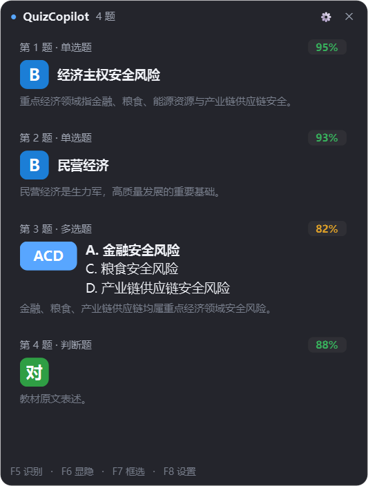

# QuizCopilot

**屏幕答题助手｜按 F5，AI 看屏幕出答案，浮在左下角**




截取你框定的一块屏幕区域 → 交给多模态模型看图答题 → 答案出现在**不抢焦点**的悬浮窗里。

---

## 特性

- **不抢焦点** — `WS_EX_NOACTIVATE` + `WA_ShowWithoutActivating`，从创建到销毁都不会被激活。点它、看它，浏览器那边 `blur` 计数永远是 0。
- **不碰页面** — 不注入脚本、不改 DOM、不自动点选项、不自动提交。只做"看屏幕 + 显示答案"。
- **平台无关** — 任何网页题库都行：学习通、雨课堂、智慧树、学堂在线、问卷星……只要能显示在屏幕上。
- **看图答题** — 截图直传多模态模型，公式、表格、带图的题都能读，没有 OCR 错字问题。
- **长图切带** — 内容高时按空白行智能切成多条横带，每张独立吃模型的分辨率预算，小字不糊。
- **模型可换** — 任何 OpenAI 兼容端点：官方 / 中转站 / 自建网关 / Ollama 视觉模型。
- **本地缓存** — 同一张截图第二次直接出结果，0 延迟 0 费用。

## 不是什么

不注入页面脚本、不自动点选项、不自动提交、不做平台检测对抗。
只做两件事：**看屏幕、显示答案**。点不点、交不交，由你决定——识别错了也不会把错答案提交上去。

---

## 快速开始

### 方式一：下载 exe（推荐）

1. 到 [Releases](https://github.com/MuXiaCol/quiz-copilot/releases) 下载 `QuizCopilot.exe`（单文件免安装，**不需要装 Python**）
2. 双击运行，托盘出现蓝色 **Q** 图标，屏幕左下角出现悬浮窗
3. 按 **F8** 打开设置 → 填 API Key → 点「测试连接」→ 保存
4. 按 **F7** 框选题目区域（只框题干和选项，别框地址栏）
5. 按 **F5** 出答案

> ⚠️ Windows 可能提示「已保护你的电脑」——exe 没有代码签名，点「更多信息 → 仍要运行」。
> 不放心可以看源码自己用 `build.ps1` 打包。

### 方式二：从源码跑

需要 Windows 10/11 + Python 3.10+。

```powershell
pwsh -File .\setup.ps1     # 建虚拟环境 + 装依赖（约 120MB，仅首次）
pwsh -File .\start.ps1     # 或直接双击 run.cmd
```

### 方式三：自己打包

```powershell
pwsh -File .\build.ps1     # 产出 dist\QuizCopilot.exe
```

> 默认接口 `https://api.deepseek.com/v1`，默认模型 `deepseek-flash`。
> **模型必须支持图片输入**，否则会报错。换其他供应商时改 `接口地址` + `模型` 两个字段即可。

---

## 用法

### 快捷键（全局生效）

| 键 | 作用 |
|---|---|
| **F5** | 识别当前区域，出答案 |
| **F6** | 显示 / 隐藏悬浮窗 |
| **F7** | 重新框选识别区域 |
| **F8** | 打开设置 |

四个都能在设置里改成别的键（格式：`F5`、`A`、`Ctrl+Alt+Q`），也可以直接编辑配置文件。

> ⚠️ 全局热键会**抢走浏览器的 F5**——程序开着时网页按 F5 不刷新。这通常是好事（答题时防误刷新），
> 介意就把 `hotkeys.capture` 改成 `Ctrl+Alt+F5`。

### 第一次用：先框选

按 **F7**，屏幕上出现半透明遮罩，**拖拽框住题目区域**（只框题干和选项，别把地址栏、导航栏、右侧目录框进去），松手即确认并立刻识别一次。

框选结果记在配置里，以后按 F5 直接识别这块区域。

> 框得越贴合题目，识别越准越快。框得太高时程序会自动切带，但精确框选永远更好。

### 托盘菜单

右键托盘图标：识别 / 显隐 / 框选 / **自动模式** / **鼠标穿透** / 设置 / 退出。

- **自动模式**：每 1.2 秒比对画面，翻页或滚动导致内容变化且画面稳定后自动重新识别，不用按 F5。
  **按 F6 隐藏悬浮窗时自动模式会一并暂停**——既不会把窗口弹回来，也不会在后台偷偷截图烧 API。再按 F6 或按一次 F5 就恢复。
- **鼠标穿透**：悬浮窗完全不吃鼠标事件（点上去等于点到下面的网页）。开了之后只能靠热键和托盘操作。

### 答案卡片怎么读

**单选题 / 判断题 / 填空题**

```
第 1 题 · 单选题                    95%
[B]  经济主权安全风险
     重点经济领域指金融、粮食、能源资源与产业链供应链安全。

第 3 题 · 判断题                    88%
[对]
     教材原文表述。
```

**多选题** — 徽章里是所有要选的字母连写，每个选中项各占一行：

```
第 3 题 · 多选题                    82%
[ACD] A. 金融安全风险
      C. 粮食安全风险
      D. 产业链供应链安全风险
      金融、粮食、产业链供应链均属重点经济领域安全风险。
```

- 左边方块 = 要选的选项字母，颜色区分 A/B/C/D，扫一眼就能对上页面上的选项
- 多选的方块是连写的字母（如 `ACD`），**每一行都是答案**，不是补充说明
- 右侧百分比 = 模型自报的把握。**低于 65% 会变红，这时建议自己看一眼题**
- 判断题只显示"对/错"徽章；填空题直接显示答案原文

---

## 思考等级

设置里的「思考等级」，或配置里的 `api.thinking`：

| 值 | 行为 | 适合 |
|---|---|---|
| `off` | 不产生思维链，直接出答案。**只有这时 `temperature` 才生效** | 纯选择/判断题，追求最快最省 |
| `low` | **默认**。思维链较短 | 大多数刷题场景 |
| `high` | 思维链较长 | 概念辨析、"下列**不包括**"这类反向设问多的题 |
| `max` | 最慢最贵 | 基本用不上 |

> **为什么默认设成 low**：`deepseek-flash` 服务端默认是「思考开启 + `high`」，
> 什么都不传等于一直在跑最高档。这里显式降下来省钱提速。
>
> 注意思考模式下 `temperature` / `presence_penalty` / `frequency_penalty` **会被忽略**
> （传了不报错，但不生效）。

如果遇到「模型没有返回可解析的 JSON」，多半是思维链把 `max_tokens` 用光了，把 `max_tokens` 调到 `4000` 即可。

---

## 配置

`%APPDATA%\QuizCopilot\config.json`（设置界面点保存会写这个文件）

```jsonc
{
  "api": {
    "base_url": "https://api.deepseek.com/v1",
    "api_key": "sk-...",              // 只存在本机，不进仓库
    "model": "deepseek-flash",        // 必须支持图片输入
    "thinking": "low",                // off / low / high / max
    "stream": true,                   // 流式输出：答案边生成边显示
    "temperature": 0,                 // 思考模式下会被忽略
    "timeout": 90,
    "max_tokens": 2000
  },
  "capture": {
    "region": [0, 0, 0, 0],           // 物理像素 [left, top, width, height]，全 0 = 整屏
    "strip_h": 1000,                  // 长图切带的目标高度
    "retry_format": "jpeg"            // 低置信复核轮的图片格式：jpeg / png
  },
  "ui": {
    "width": 430,
    "opacity": 0.94,
    "margin": 14,
    "show_reason": true,
    "max_height_ratio": 0.72,
    "click_through": false
  },
  "behavior": {
    "auto_mode": false,
    "poll_interval_ms": 800,          // 自动模式轮询间隔
    "settle_polls": 2,                // 连续几个周期画面不变才算"稳定"
    "change_tolerance": 0.02,         // 差异比例容差（光标闪烁不会误判为变化）
    "use_cache": true,
    "vote_low_confidence": true,
    "low_confidence": 0.70
  },
  "hotkeys": {
    "capture": "F5",
    "toggle": "F6",
    "pick": "F7",
    "settings": "F8"
  }
}
```

同目录下其他文件：

| 文件 | 用途 |
|---|---|
| `cache.db` | 答案缓存，同一张截图第二次直接出结果。删掉即清空 |
| `quizcopilot.log` | 运行日志，出问题先看这个 |

---

## 原理

```
F5
 └→ mss 截取框定区域（物理像素）
     └→ 按空白行切成若干横带（长图才切，保证小字不被缩糊）
         └→ PNG + base64，作为 image_url 块发给多模态模型
             └→ 模型返回 JSON：题号 / 题型 / 答案字母 / 选项原文 / 置信度 / 理由
                 └→ 低置信度题再问一次，取更有把握的版本
                     └→ 写 sqlite 缓存 → 渲染成卡片 → 窗口钉在左下角
```

几个实现上值得看的点：

| 点 | 位置 | 说明 |
|---|---|---|
| 不抢焦点的窗口 | `app/win32util.py` `app/ui/overlay.py` | `WS_EX_NOACTIVATE \| WS_EX_TOOLWINDOW`，且代码里从不调用 `activateWindow()` |
| 按空白行切带 | `app/imageutil.py` | 扫每行墨量找空白带当切点，避免把一道题拦腰截断 |
| 透明窗里的白块 | `app/main.py` `_apply_dark_palette` | `WA_TranslucentBackground` 只对顶层生效，子控件仍走调色板 |
| 两拍布局收敛 | `app/ui/overlay.py` `_relayout` | 新控件要等一次 polish 才有 sizeHint，所以同一轮内算两次 |
| 全局热键 | `app/hotkeys.py` | `RegisterHotKey` + `nativeEventFilter`，不装键盘钩子、不要管理员权限 |

---

## 常见问题

**按 F5 没反应？**
看托盘图标还在不在；看悬浮窗状态栏有没有"热键占用"提示——F5 被别的软件占了就去设置里换键。

**提示"模型没有返回可解析的 JSON"**
模型名不对或模型不支持图片输入。确认 `model` 是 `deepseek-flash` 或你那边支持视觉的模型。

**答案不准 / 漏题**
九成是框选区域不对。按 F7 重新框，只框题目和选项。区域太矮会漏掉下面的题，太高会被切成多张图。

**能不能自动把选项点上？**
不能，这是设计取舍。程序只显示答案，点不点由你来——这样不会因为识别偏差把错答案提交上去。

**怎么确认它真的不抢焦点？**
浏览器控制台挂个探针再按 F5、点悬浮窗：
```js
window.__blur = 0;
addEventListener('blur', () => window.__blur++);
// 操作完看 window.__blur，应该还是 0
```

---

## 开发

```powershell
pwsh -File .\setup.ps1

# 单元 + 端到端（不需要 API Key）
.\.venv\Scripts\python.exe tests\smoke.py
.\.venv\Scripts\python.exe tests\mock_api_test.py

# 真实窗口启动测试（会弹 2.8 秒窗口，并短暂注册 F5~F8）
.\.venv\Scripts\python.exe tests\launch_test.py
```

`tests/mock_api_test.py` 起一个本地 HTTP 服务冒充模型接口，验证"截图 → 切带 → 请求体 → JSON 解析 → 缓存"
整条链路，不需要真 Key，也不会产生费用。

提 PR 前请先看 [CONTRIBUTING.md](CONTRIBUTING.md)。

### 项目结构

```
app/
  main.py            装配：托盘、热键、流水线、深色调色板
  config.py          配置读写（%APPDATA%\QuizCopilot）
  screen.py          截图 / 屏幕几何 / 画面变化检测
  imageutil.py       PNG 编码 + 按空白行智能切带
  solver.py          提示词、请求、JSON 解析、低置信度复核、缓存
  cache.py           sqlite 答案缓存
  pipeline.py        后台线程 + 自动模式轮询
  hotkeys.py         RegisterHotKey
  win32util.py       WS_EX_NOACTIVATE / 置顶 / 鼠标穿透
  ui/
    overlay.py       悬浮窗
    card.py          答案卡片
    region_picker.py 全屏框选
    settings_dialog.py
    theme.py
tests/
  smoke.py           离线冒烟：JSON 解析 + 窗口构建
  mock_api_test.py   端到端：本地 mock 服务
  launch_test.py     真实窗口启动测试
```

---

## 已知限制

- **模型会错**。百分比是模型自报的把握，不是真实正确率；多选、图表题的实际错率明显更高。
- **全局热键会抢占浏览器的 F5**，程序运行期间网页不刷新。
- **多屏混 DPI**：区域坐标按虚拟桌面整体比例换算，各显示器缩放不一致时可能偏几像素，重框一次即可。
- **只支持 Windows**。窗口不抢焦点那一层是纯 Win32 实现。

## 许可

[MIT](LICENSE)。软件按原样提供，不附带任何担保；识别结果仅供参考，使用后果由使用者自行承担。
